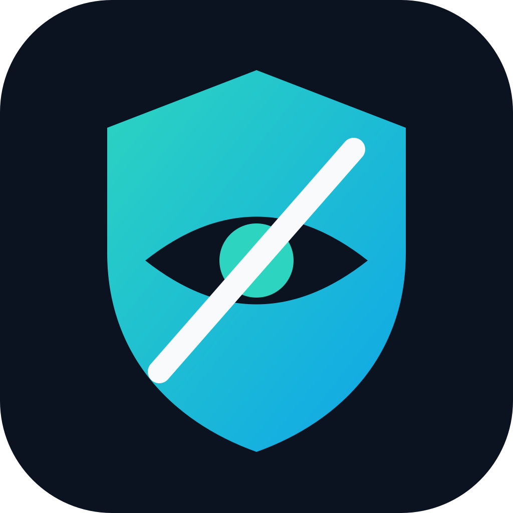

  

<h1 align="center">ScreenShield</h1>

An <strong>unofficial</strong> desktop app that hides its windows from screen capture and screen sharing.

> # ⚠️ UNOFFICIAL — NOT T3 CODE
>
> **ScreenShield is an unofficial, third-party fork based on the T3 Code source code. It is _not_ T3 Code. It is
> _not_ affiliated with, endorsed by, sponsored by, or maintained by T3 Tools, Inc., and it is _not_ an official
> version of T3 Code.** Do not report problems with it to T3 Tools, Inc.
>
> The real T3 Code is available only from [t3.codes](https://t3.codes) and
> [github.com/pingdotgg/t3code](https://github.com/pingdotgg/t3code). "T3", "T3 Code" and their logos belong to
> T3 Tools, Inc.; they are named here only to say where this code comes from. See T3's
> [TRADEMARK.md](./TRADEMARK.md).

## What it is

ScreenShield is based on the open-source [T3 Code](https://github.com/pingdotgg/t3code) source code (MIT
licensed, see [LICENSE](./LICENSE)), with these additions:

- hides every app window from **screen capture and screen sharing**;
- hides the app from the **taskbar** while that is on, because a full-screen share would otherwise show it;
- **on by default**, with an always-visible eye button and a `Ctrl+Alt+Shift+T` shortcut to bring the window back.

**Windows only for now.** On Linux the app runs, but the window stays visible to screen sharing, and the app says
so. macOS is untested.

## Download and docs

- **[Releases](../../releases)**: the Windows installer (unsigned, so Windows SmartScreen will warn).
- **[SCREENSHIELD.md](./SCREENSHIELD.md)**: how it works, platform support, why Linux does not work and what it
  would take, build instructions, packaging fixes, security limits, and the project history.

## Naming

The project is named ScreenShield (repository: `CorporateStreamSecureWrapper`). Internal package names such as
`@t3tools/*`, the bundled `t3` command-line tool and some identifiers still carry the upstream name because they
are part of the inherited code.

## License

The source code is licensed under the [MIT License](./LICENSE), including its original T3 Tools, Inc. copyright
notice. The license covers the source code only; it grants no rights to T3's trademarks.
